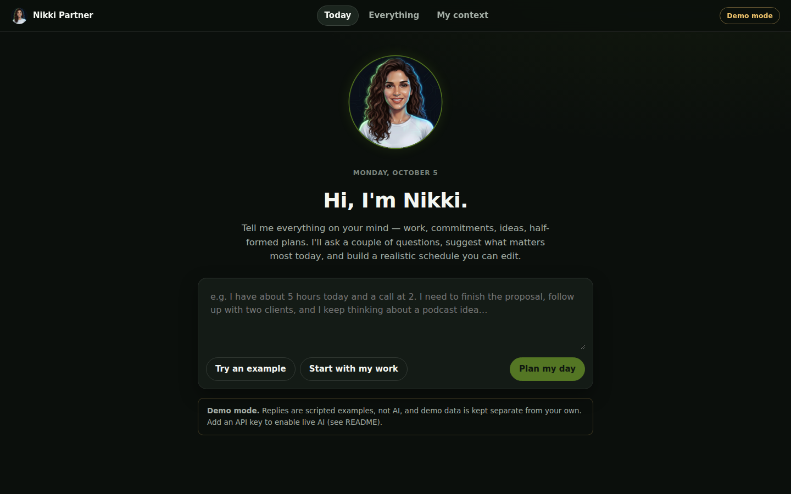
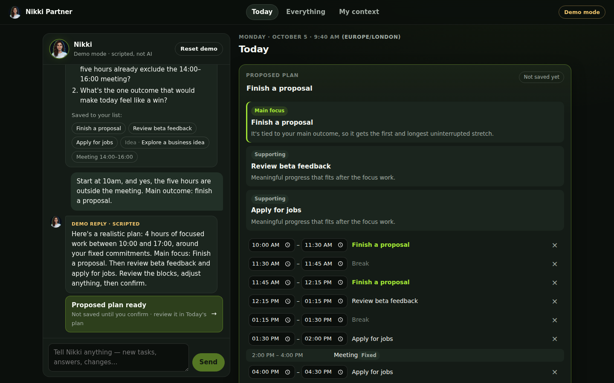
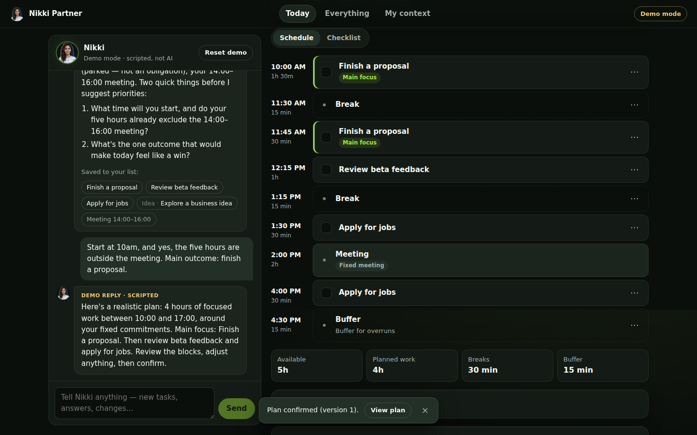
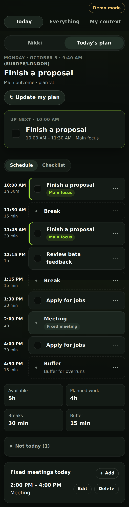

# Nikki

A personal planning partner. You tell Nikki everything on your mind in your own words; she asks a few useful questions, recommends one main focus plus up to two supporting actions, proposes a realistic schedule around your fixed meetings, and updates the plan when you come back.

**Flow:** capture → clarify → propose → confirm → complete → revise.



| Proposal (editable, not saved until you confirm) | Confirmed plan | Mobile |
| --- | --- | --- |
|  |  |  |

- **Frontend:** React + Vite + TypeScript (`src/`)
- **Backend:** Node + Express (`server/`), talking **directly** to the Claude API with the official Anthropic SDK. No n8n, webhooks or workflow platforms.
- **Storage:** SQLite (`data/nikki.db`), survives refreshes and restarts.
- **Demo mode:** works with no API key, using scripted (non-AI) replies and a separate database.

---

## 1. Run it on your computer

You need **Node.js 20 or newer** ([nodejs.org](https://nodejs.org), pick the "LTS" download). To check, open a terminal and run `node -v`.

Run each command in a terminal:

```bash
# 1. Get the code (skip if you already have it)
git clone https://github.com/pcherian89/Nikki_Partner.git
cd Nikki_Partner

# 2. Install dependencies (one time)
npm install

# 3. Create your settings file (one time)
cp .env.example .env        # on Windows PowerShell: copy .env.example .env

# 4. Build the app and start it
npm run build
npm start
```

Then open **http://localhost:3001** in your browser.

With no API key, the app opens in **Demo mode**. Tap **Try an example** to see the whole flow.

To stop the server, press `Ctrl + C` in the terminal. Your data stays in `data/nikki.db`.

**For development** (auto-reload when you edit code): run `npm run dev` and open http://localhost:5173.

**Run the automated tests:** `npm test`

---

## 2. Turn on live AI (your Anthropic API key)

The key stays on the server, in your `.env` file. It is never sent to the browser, and `.env` is excluded from Git.

1. Go to **https://platform.claude.com** and sign in, or create an account.
2. Open **Settings → Billing** and add credit. API usage is billed separately from a Claude.ai subscription.
3. Open **Settings → API keys**, click **Create key**, name it `nikki-partner`, and copy the key (it starts with `sk-ant-`). It is only shown once.
4. Open the `.env` file in the project folder with any text editor and paste the key after the `=` sign:
   ```
   ANTHROPIC_API_KEY=sk-ant-...your key...
   ```
   Save the file. **Never** paste the key into chat, code, or a GitHub file.
5. Stop the server (`Ctrl + C`) and start it again with `npm start`. The terminal should say `Live AI: ON (model claude-opus-5-5)`.
6. In the app, click the badge at the top right (or go to **My context → Mode**) and choose **My workspace · Live AI**.

**Model:** the default is `claude-opus-5-5`, Anthropic's current default Opus model. To change it, set `ANTHROPIC_MODEL` in `.env`, for example `ANTHROPIC_MODEL=claude-sonnet-5-5` for lower cost, and restart.

If something is wrong, the app shows the actual error, such as a rejected key, a rate limit, a timeout, or a network problem. It never silently replaces a failed live reply with a demo reply.

---

## 3. Where the app runs: three different things

| | What it is | Persistent? | Who can open it |
| --- | --- | --- | --- |
| **Claude Code build environment** | The temporary cloud container where this app was built and tested | **No.** It is deleted after the session | Nobody else. It has no public link |
| **Your computer** (`npm start`) | The real app, running locally | Yes, in `data/nikki.db` on your disk | Only you, at `http://localhost:3001` |
| **Hosted deployment** | The app running on a server with a web address | Yes, **only if** the host gives SQLite a durable disk | Anyone with the link, so it **must** have a password |

The Claude Code session couldn't give you a live browser preview link. Use the screenshots above, or run it locally (section 1). That takes about two minutes.

### Hosting it online (Railway)

The repository is ready for [Railway](https://railway.com). Railway gives the app a server that's always on, plus a **volume** (a persistent disk) so the SQLite database survives restarts and redeploys. Settings are in `railway.json`.

1. Sign in to Railway with GitHub. Create **New Project → Deploy from GitHub repo → Nikki_Partner**.
2. Add a **Volume** to the service, mounted at `/data`.
3. Under **Variables**, set:
   - `DATABASE_PATH=/data/nikki.db`
   - `ANTHROPIC_API_KEY=` your key
   - `ANTHROPIC_MODEL=claude-opus-5-5`
   - `APP_PASSWORD=` a long password, at least 10 characters
4. Under **Settings → Networking**, click **Generate Domain** to get a `https://….up.railway.app` link.
5. Open the link, log in with your password, then go to **My context → Import from a file** and import the export you downloaded from your Mac.

Safety: on Railway (or anywhere `PUBLIC_DEPLOYMENT=true` is set), the app **refuses to start** without an `APP_PASSWORD` of at least 10 characters.

To use your own domain later (for example `nikki.revivosporttech.com`), add it under **Settings → Networking → Custom Domain**, then add the CNAME record Railway shows you at your domain provider.

### Backups and rolling back an update

Your data is one SQLite file (`/data/nikki.db`) on the Railway volume. Updates to Nikki's code never delete it, and changes to how data is stored are **additive only** (new tables or columns are added; nothing is dropped or rewritten), so the previous version of the code can still read a migrated file.

Three layers of protection:

1. **Automatic copy before an upgrade.** The first time a new version starts on an existing database whose layout is older, Nikki copies it next to itself (for example `nikki.db.v0-before-v2-2026-10-21T….bak`) *before* changing anything, and keeps the five most recent copies. The deploy log says `[db] Saved a copy of nikki.db before upgrading it`. These sit on the same volume, so they protect against a bad upgrade, not against losing the volume.
2. **Your own copy, off the server.** **Context → Data → Export my data** downloads everything as a file (tasks, plans and every plan version, work sessions, outcomes, journal, settings). Do this before any big change. **Import from a file** puts it back.
3. **Plan history is never overwritten.** Every plan edit adds a new version; old versions stay in the database, and the day's record (**Earlier today**) is built from them.

**To roll back after a bad update:**
1. In Railway, open the previous good deployment (**Deployments → ⋯ → Redeploy**) — or revert the commit on GitHub. Because changes are additive, your data keeps working with the older code.
2. Only if the data itself looks wrong: in Railway's **Console** tab for the service, list the copies with `ls -l /data`, then make a working copy of the one you want — `cp /data/<the .bak file> /data/nikki-restored.db` (never overwrite the live `nikki.db` while the app is running) — and in **Variables** set `DATABASE_PATH=/data/nikki-restored.db`. Nikki restarts on the restored copy. To go back, set `DATABASE_PATH=/data/nikki.db` again.
3. Or use **Import from a file** with an export you downloaded earlier.

---

## 4. Settings (`.env`)

| Variable | Meaning | Default |
| --- | --- | --- |
| `ANTHROPIC_API_KEY` | Your Claude API key. Empty = Demo mode only | (empty) |
| `ANTHROPIC_MODEL` | Claude model used for planning | `claude-opus-5-5` |
| `DATABASE_PATH` | Personal SQLite file. Demo data goes in `nikki-demo.db` next to it | `./data/nikki.db` |
| `PORT` | Web server port | `3001` |
| `APP_PASSWORD` | Password prompt for the whole app. **Required for public hosting** | (empty = no login) |

---

## 5. How it works

### Views

- **Home:** the full-body Nikki welcome screen. Reach it with the Home tab or by clicking the Nikki logo. When you come back, it summarises where you are and lets you tell Nikki anything new.
- **Today:** conversation with Nikki beside today's plan. Shows the main outcome, an obvious "Now / Up next" item, schedule or checklist view, editable time blocks, fixed meetings, a time summary (available, planned work, breaks, buffer), collapsed "Not today", completed tasks with Undo, and **Update my plan**. Each work block has: Need more time (+15/+30), I'm blocked, Move out of today, Move/edit time.
- **Everything:** active actions, waiting/blocked, parked ideas, reference notes, completed. You can add, edit, delete, change status, and deliberately promote an idea into an action.
- **My context:** name, businesses/projects, goals, main outcome, commitments, working hours, timezone and preferences. All fields are optional and editable. This view also has the mode switch, data export, and data deletion.

### Today, tomorrow and what's coming up

- **Today / Tomorrow / Week switch** at the top of the plan. Ask Nikki to "plan tomorrow", for example after your evening wrap-up. Tomorrow's plan is proposed, edited and confirmed the same way as today's, and becomes today's plan the next morning.
- **Commitments on any date**: tell Nikki "client review next Monday 3–4pm" and it's saved for that date.
- **Week view**: the next 7 days, each with its plan, meetings, deadlines and the tasks you've planned for that day. Exact times are only set for today and tomorrow. Assign unscheduled tasks to a day yourself, or click "Plan my week with Nikki" to have her suggest days for you to confirm. A "Later" list shows events and deadlines up to 30 days ahead.
- **Daily brief on Home**: your focus, what's next, progress on today's planned work, and what's coming up.
- **Quick replies**: tap-to-send answers under Nikki's latest message. **Voice**: click the mic, speak, and your words are typed into the message box (Chrome, Edge and Safari).
- **My context as items**: each project, goal, commitment and preference is its own item. Click an item to edit it, or click × to delete it (with Undo). Nikki can suggest adding or removing items, for example "I'm not working on X any more", but nothing changes until you confirm.
- **Saved context stays clean**: for list fields (projects, goals, commitments, preferences), Nikki only *adds* new lines, so nothing is ever removed. Single values (name, hours, timezone) show a before → after. Suggestions you've saved or dismissed don't come back, and duplicate lines are removed automatically.

### Linked calendars (Google, Apple, Outlook)

In **My context → Linked calendars**, paste a private calendar link. For Google, that's "Secret address in iCal format". For Apple, it's a Public Calendar share link. Nikki then reads your events for the next 30 days, including repeating ones, so they appear in Today, Tomorrow and Week as fixed meetings, and plans fit around them.

- It's **read-only**: Nikki never changes your calendar. To change a calendar event, change it in your calendar.
- Calendars sync every 15 minutes while the app is running, and whenever you open it. There's also a **Sync now** button.
- All-day events and cancelled events are skipped.
- The private link stays on the server and is never shown in full in the browser. It is included in data exports, so keep exports private.

### Nikki in your calendar (Google or Apple)

In **My context → Nikki in your calendar**, click **Create my calendar link**, then subscribe to it in Google Calendar (**Other calendars → + → From URL**) or Apple Calendar (**File → New Calendar Subscription**). A separate "Nikki" calendar then shows your confirmed focus blocks and tasks for today and tomorrow, meetings you added in Nikki, and tasks planned for a day in the Week view.

- The link only works once Nikki is hosted online, because calendar apps can't reach your computer.
- The link is secret; anyone who has it can see your plans. **Reset link** makes the old one stop working.
- Google refreshes subscribed calendars every few hours; Apple can refresh every 5–15 minutes.

### Daily rhythm, task help and learning

- **Evening wrap-up** (Today → "Wrap up my day"): see what got done, then decide what happens to each unfinished item (Tomorrow, Done, Park or Drop) and add an optional note. This needs no AI. You can also ask for a short reflection from Nikki, which is one AI message (scripted in Demo mode).
- **Morning check-in**: the next day, Today shows what you finished, what's carrying over and your note. "Start my check-in with Nikki" pre-fills a message so planning picks up where you left off. Carried-over items are sent to the model as strong candidates.
- **Break it down**: turns a task into 3–8 small steps with minute estimates. You can edit them before saving, then tick them off under the task.
- **Help me start**: Nikki drafts something useful for the task, such as an email, outline, checklist or post. Unknown details are shown as `[placeholders]` and never invented. Drafts are saved with the task and can be copied.
- **Learning your pace**: use the focus timer on a task, or say how long a finished task took in "Completed today". After 3 measured tasks, Nikki calculates how your real time compares with your estimates (overall, and per project) and plans with it. See My context → "What Nikki has learned about your pace".

In Demo mode, steps and drafts come from clearly labelled templates, not AI.

### What is and isn't automatic

- Opening or refreshing the app **loads saved state only**. It never calls the model.
- Ticking a checkbox crosses the task out immediately and saves it, with an Undo option. If saving fails, the change is rolled back and an error is shown. No model call.
- Nikki's **plan is only a proposal**. You can edit it, and it's saved only when you click **Confirm**. Changes Nikki suggests to existing tasks are also confirmed by you.
- New items and timed meetings **you mention** are saved to your list right away and shown under the reply as "Saved to your list". You can delete them in Everything or Today.
- **Personal facts Nikki infers** (goals, working hours, your name…) appear as "Save to My context?" suggestions. They are never saved without your click.
- **Same-day return:** your confirmed plan is restored. **New day:** if yesterday's plan has unfinished items, Nikki offers to review them first (Keep / Done / Park / Drop).
- **Replanning** asks until when you can keep working. It keeps completed work and fixed meetings, schedules only from now on, shows the changes, and creates a new plan version when you confirm.

### Memory: what is sent to Claude

Memory is stored **by this app** in SQLite. On each request the server sends only:

- Nikki's instructions
- your confirmed context
- relevant open tasks (bounded) and today's done items
- today's meetings
- the current confirmed plan
- the last ~16 messages (character-capped)
- the current date, time, timezone and availability

It does **not** send the whole database. Structured saved facts take precedence over chat history. This is not model training: Claude doesn't remember anything between requests.

### Assistant instructions and response schema

- System instructions: [`server/prompt.ts`](server/prompt.ts) (`SYSTEM_PROMPT`). The per-request context block is built by `buildAppState`.
- Response schema: [`server/schema.ts`](server/schema.ts). It is sent to the API as structured output (`output_config.format`) and re-validated on the server with Zod. The schema is kept small, using `""` and `0` instead of nulls, because the API rejects overly complex schemas. If the API ever rejects the schema anyway, the server switches once to asking for JSON in the instructions, and still validates every reply. Every reply contains:
  - `message`
  - `questions` (≤ 2)
  - `captured_items` (actions / ideas / reference)
  - `task_updates`
  - `meetings`
  - `context_updates`
  - `availability`
  - `plan` (main outcome, focus, ≤ 2 supporting, deferred, window, work budget, time blocks, reasons, assumptions)

### Server-side validation ([`server/validate.ts`](server/validate.ts))

Every proposed or edited plan is checked for:

- valid `HH:MM` times and dates
- valid task references
- no overlapping blocks
- blocks inside the available window
- no overlap with fixed meetings
- meetings not moved
- work time within the confirmed budget, and the budget within the free time
- at most two supporting actions
- no re-scheduling of completed tasks
- for replans, no blocks in the past

If a live reply fails these checks, Claude gets **one** repair attempt with the list of problems. If it still fails, the plan is dropped and Nikki explains why. There are no unlimited retries.

Each confirmed plan is saved as a numbered **version**. A proposal can only be confirmed if the plan hasn't changed since it was made, so stale proposals are rejected. Each message has a client request ID, so double-clicking Send can't create duplicates. Only one model call runs at a time per workspace. The SDK retries once on rate limits and server errors, with a 90-second timeout.

### Model provider

[`server/provider/types.ts`](server/provider/types.ts) defines a small `PlannerProvider` interface. Only Anthropic is implemented ([`server/provider/anthropic.ts`](server/provider/anthropic.ts)). It uses adaptive thinking at `medium` effort, structured output, and Anthropic's server-side refusal fallback (`fallbacks: "default"`).

### Endpoints

`GET /api/state` · `POST /api/messages` · `POST /api/replan` · `POST /api/proposals/:id/confirm|discard` · `POST /api/proposals/:id/suggestions/:sid` · `PUT /api/profile` · `POST/PATCH/DELETE /api/tasks` · `POST/PATCH/DELETE /api/meetings` · `PUT /api/plan` · `POST /api/review` · `GET /api/export` · `DELETE /api/data` · `POST /api/demo/reset`

The workspace is chosen with the `X-Workspace: personal|demo` header. The browser's timezone is sent as `X-Timezone`, and the timezone saved in My context overrides it.

---

## 6. Nikki's avatar

- `public/nikki/nikki-full.webp`: the full-body 3D-style Nikki you provided. It is shown large on the welcome screen with a gentle CSS "breathing" motion, which is switched off for users who prefer reduced motion. The original is kept in `references/nikki-full-reference.webp`.
- `public/nikki/nikki-avatar.png`: a round face crop from the same image, used in the header and chat.
- The first illustration is kept in `references/nikki-reference.png`.

**To replace either image:** save the new file with the same name, then run `npm run build` again. If an image can't load, the app falls back to the round portrait or an "N" monogram, so it never shows a broken image.

## Using Nikki day to day

- **Capture anything** in the box on Today ("+ Add task") or in chat: "Add five tasks for tomorrow", "The report is due Friday at 4 PM, high priority". A task needs only a title. A day, priority and deadline are separate and optional; nothing is scheduled until you ask.
- **Tasks have no time by default**, whether added by hand or in chat. Give one a time with **+ Add time** (or ⋯ → Add time…); Nikki only proposes a schedule when you ask her to plan.
- **Start any task** with its Start button. Pause, resume or finish whenever. Forgot the timer? ⋯ → **Add time worked**. A timer that ran for hours is shown as "needs a check" and isn't counted until you confirm or correct it.
- **Plan the day only if you want to**: tell Nikki "Plan my day". Times you name ("call the bank at 3") are pinned and kept when she replans. A plan shows what's **not scheduled** and what's **at risk**.
- **Reminders**: "Remind me tomorrow morning to follow up on the proposal", or Today ⋯ → Add a reminder. Due reminders appear at the top of Today. For notifications while Nikki is closed: Context → *Reminders & notifications* → Turn on, then **Send a test**. It says "Verified" only after the test actually arrives on your device (on iPhone, add Nikki to your Home Screen first).
- **Projects**: tell Nikki about a goal that takes weeks or months. She asks only what she needs, proposes milestones and first tasks, and saves nothing until you confirm. Find projects at the top of **Everything**. Project tasks stay off Today until you add them.
- **Decisions and priorities**: talk them through in chat. Nikki compares options, says what she doesn't know, and may challenge a plan. Nothing changes until you confirm. See, correct or remove what she remembers in **Context → What Nikki remembers**.
- **Weekly review**: Today ⋯ → Weekly review.
- **Checking the real AI**: `ANTHROPIC_API_KEY=… npm run check:live` runs a short script against the real Claude API using a throwaway database.

## 7. Status: what's verified, simulated and untested

**Verified in the build environment** (automated tests in `server/tests/flow.test.ts` plus a scripted Chromium run):

- production build
- desktop (1440px) and mobile (390px) layouts, with no horizontal scroll on mobile
- the full demo flow: capture → 2 clarifying questions → proposal → confirm → complete → Undo → replan → new version
- persistence after page refresh and after a server restart
- new-day review
- timezone handling
- overlap, meeting, window and budget validation
- stale-proposal and stale-edit rejection
- duplicate and concurrent submissions
- the missing-API-key error
- API failures (rate limit, invalid JSON, invalid plan → one repair attempt), using a fake provider
- export and delete
- demo/personal data separation

**Stages C–F, verified in the build environment** (`npm test`: 116 tests including `integrated.test.ts`, a 15-step story across several days; plus scripted Chromium runs at 1280px and 390px):

- Stage D: reminders in-app, task- and project-anchored, fired exactly once, persisted across restarts; push logic with a simulated push service
- Stage E: projects confirmed by the user, linked to ordinary tasks, progress from real states
- Stage F: confirmed-only memory with expiry and a size cap, weekly review counts, discussion never creating anything

**Stage C (task-first planning), verified in the build environment** (`server/tests/stagec.test.ts` + scripted Chromium at 1280px and 390px):

- tasks with an assigned day, priority, optional flag and deadline (with time), none of which create a scheduled block
- start any task without a plan; pause, resume, switch (the server refuses a silent second timer) and finish
- time added after the fact (minutes or from–to) with duplicate/overlap checks; unknown time is never invented
- a timer left running or started on another device is shown with its state and never counted until confirmed or corrected
- Nikki's chat actions run through the same functions as the buttons, with receipts and Undo; failed actions are fed back to the next turn
- finishing a task no longer marks earlier planned blocks done

See `docs/planning-spec.md` for the approved behaviour, the Stage E (projects/goals) roadmap and how Stage C stays compatible with it.

**Simulated:**

- **Demo mode** is rule-based. It understands simple phrasing ("5 hours", "2–4 meeting", "I need to A, B and C") and follows a script. It is clearly labelled and is not AI.
- In the automated tests, live-mode behaviour is exercised with a **fake** provider.

**Not yet tested:**

- **Stages C–F with a real model.** `npm run check:live` exists for this and was not run (no API key in the build environment; the Claude API itself was reachable).
- **Closed-app notifications on a real device.** Push is built; delivery to a phone or browser has not been observed. It is shown as "Verified" in the app only after your device confirms a test.
- **Stage C on Railway.** Not deployed or checked from the build environment; a push is not proof that it is running.
- The demo planner still uses internal duration guesses to build its scripted plan; blocks built that way are labelled provisional and the task keeps no estimate.

- **Real calls to Claude.** No API key was available in the build environment, so the quality of Nikki's live replies and the exact structured-output behaviour with a real key still need a first run on your machine.
- Real browsers other than Chromium (Safari, Firefox, iOS).
- Hosting on a real host. Password protection was checked locally: requests are rejected without the password and accepted after login.
- Very long histories.
