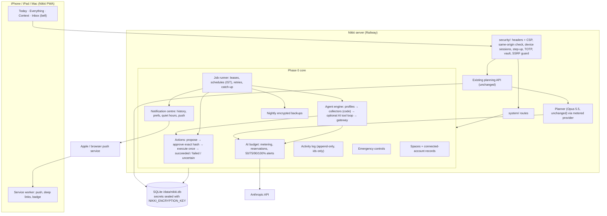

# Nikki architecture (after Phase 0)

Maintained alongside the code. If you change how something below works, update this file in the same commit.

## Shape

One Node 22 server (Express 5 + tsx) on Railway, one SQLite database on the Railway volume, a React PWA served by
the same server. No extra services, queues or paid infrastructure.

## Principles enforced in code

1. **Code first, AI second.** Collectors, schedules, budgets and permissions are plain code. AI runs only when a
   profile turns it on, and only inside the budget.
2. **Nothing consequential without the user.** Agents can only *propose*. An approval is bound to a SHA-256 hash of
   the exact parameters (and time); editing clears it; consequential approvals last one hour and need a recent
   password check; an approval does not carry over to a later day.
3. **Never blindly retry.** External actions whose outcome is unknown become `uncertain` and wait for the user.
   Idempotency keys stop duplicate *requests*; they do not guarantee an external provider won't repeat an effect.
4. **Permissions are not prompts.** The tool gateway checks the allow-list, level, space and call limits on every
   call. Only the user can widen an agent's permissions; AI-made or system-made profiles start disabled.
5. **Spaces are walls.** Each account, agent and action lives in one space. The government space is confidential:
   off by default, never sent to AI, no accounts in Phase 0.
6. **Secrets are sealed.** AES-256-GCM, key only in the server environment, bound to their storage row, rotatable.
7. **Nikki is the only interface.** Approvals and notifications live in the in-app inbox; push is a copy.

## Modules

| Path | Purpose |
| --- | --- |
| `server/security/vault.ts` | AES-256-GCM sealing, key ids, rotation, file encryption |
| `server/security/secrets.ts` | The only reader/writer of the `secrets` table |
| `server/security/auth.ts` | Device sessions, rate limits, step-up, TOTP, recovery codes |
| `server/security/totp.ts` | RFC 6238 codes (no dependency) |
| `server/security/http.ts` | Security headers, CSP with inline-script hash, same-origin check |
| `server/security/ssrf.ts` | Outbound URL checks for user-supplied links (calendar feeds) |
| `server/system/schema.ts` | Phase 0 tables (additive, schema v7) |
| `server/system/actions.ts` | Approval and execution pipeline; Nikki-internal handlers |
| `server/system/jobs.ts` | Persistent job runner |
| `server/system/budget.ts` | Pricing, spend, reservations, alerts, credit exhaustion |
| `server/system/notifications.ts` | Notification centre and push payloads (incl. Declarative Web Push) |
| `server/system/spaces.ts` | Spaces, account records, permission levels |
| `server/system/controls.ts` | Emergency switches |
| `server/system/activity.ts` | Append-only activity log |
| `server/system/backup.ts` | Encrypted nightly backups |
| `server/system/bootstrap.ts` | Start-up: seed, seal, recover, schedule |
| `server/system/routes.ts` | `/api/system/*` |
| `server/agents/profiles.ts` | Agent configuration and its safety rules |
| `server/agents/tools.ts` | Tool registry and permission gateway |
| `server/agents/model.ts` | Agent model interface (Haiku 5.5 / Sonnet 5.5 / Opus 5.5 tiers) |
| `server/agents/engine.ts` | The one agent engine |
| `src/components/Safety.tsx` | Inbox, bell, safety, budget, notifications, security, agents screens |

## Permission levels

| Level | Meaning | Runs without approval? |
| --- | --- | --- |
| read | Look at Nikki's data | yes |
| prepare | Draft or notify the user | yes |
| change | Change something in Nikki | no: proposal |
| consequential | Anything outside Nikki or hard to undo (sending email, calendar changes for others) | never: approval + recent password, 1-hour validity |
| prohibited | Never (deleting mail, payments, security settings) | never |

## Adding a connector later (Phase 1+)

1. Register an `ActionHandler` for each effect (`external: true`, correct level, strict zod schema, a `reconcile`
   function if the provider lets us check whether something happened).
2. Register read tools in `agents/tools.ts` with the spaces they serve.
3. Store tokens with `storeAccountCredential` (sealed; refused without a key). Delete on disconnect.
4. Google: use the official Workspace MCP servers (required for AI agents from 1 Feb 2027). Derived data from Google
   may not be kept more than 30 days, and nothing after disconnect.
