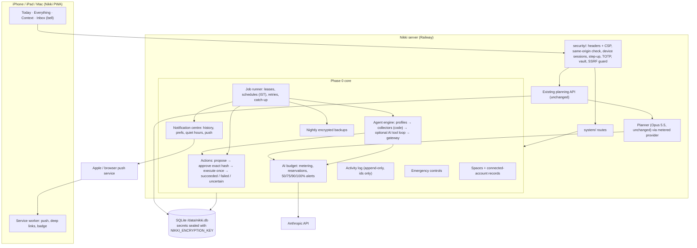

# Nikki architecture (after Phase 0)

Maintained alongside the code. If you change how something below works, update this file in the same commit.

## Shape

One Node 22 server (Express 5 + tsx) on Railway, one SQLite database on the Railway volume, a React PWA served by
the same server. No extra services, queues or paid infrastructure.

## Principles enforced in code

1. **Code first, AI second.** Collectors, schedules, budgets and permissions are plain code. AI runs only when a
   profile turns it on, and only inside the budget.
2. **Nothing consequential without the user.** Agents can only *propose*. An approval is bound to a SHA-256 hash of
   the exact parameters (and time); editing clears it; consequential approvals last one hour and need a recent
   password check; an approval does not carry over to a later day.
3. **Never blindly retry.** External actions whose outcome is unknown become `uncertain` and wait for the user.
   Idempotency keys stop duplicate *requests*; they do not guarantee an external provider won't repeat an effect.
4. **Permissions are not prompts.** The tool gateway checks the allow-list, level, space and call limits on every
   call. Only the user can widen an agent's permissions; AI-made or system-made profiles start disabled.
5. **Spaces are walls.** Each account, agent and action lives in one space. The government space is confidential:
   off by default, never sent to AI, no accounts in Phase 0.
6. **Secrets are sealed.** AES-256-GCM, key only in the server environment, bound to their storage row, rotatable.
7. **Nikki is the only interface.** Approvals and notifications live in the in-app inbox; push is a copy.

## Three kinds of confirmation (pre-deployment review, 28 Nov 2026)

| What | Example | How it is confirmed |
| --- | --- | --- |
| Something you asked for in chat | "Add a task to call Ravi" | The existing Confirm / Undo in chat. Never sent to the inbox, never approved twice |
| An agent's suggestion inside Nikki | Daily Briefing suggests a reminder | Inbox → To review. The button names the action (Create task, Add reminder); the card says why and what happens |
| An action that leaves Nikki or can't be undone (Phase 1+) | Send an email, add a calendar event | Inbox, plus a password re-check; approval lasts 1 hour; an unknown outcome becomes "uncertain" |

Only the agent tool gateway calls `proposeAction` (a test checks this). Each action kind declares `noun`,
`approveLabel` and `consequence`, so new kinds bring their own wording without changing the approval check.

## Stop and resume

- **Stop** (`stopEverything`) sets `agentsPaused` and `actionsPaused` in settings, so it survives restarts.
- No agent run starts; a running agent checks before every model call and every tool call and ends as
  `stopped_paused`. A model request already sent can't be recalled: it finishes and is counted.
- No action executes and none can be approved (HTTP 423). Scheduled items wait.
- Nothing already done outside Nikki can be reversed by the switch.
- **Resume** (`/api/system/resume-all`) clears both flags, then `requeueAfterResume` returns every approved or
  scheduled item that is now due to `pending` with its approval cleared, and sends one "Please confirm again" note.
  Future scheduled items keep their time and face the usual approval-expiry check when it comes.
- Planning, chat, tasks, reminders and data are never affected.

## Budget scope

- `monthlyUsd` ($5) covers all AI Nikki calls: planning chat, task helpers and agents.
- `dailyUsd` ($0.25) applies to background agents only.
- Agents reserve a worst-case estimate before each call and stop before exceeding either limit.
- Planning chat keeps working at the limit unless `blockPlannerAtLimit` is chosen. From 90% a banner shows above the chat.
- `ai_metering_since` records when counting began; nothing earlier is imported.

## Modules

| Path | Purpose |
| --- | --- |
| `server/security/vault.ts` | AES-256-GCM sealing, key ids, rotation, file encryption |
| `server/security/secrets.ts` | The only reader/writer of the `secrets` table |
| `server/security/auth.ts` | Device sessions, rate limits, step-up, TOTP, recovery codes |
| `server/security/totp.ts` | RFC 6238 codes (no dependency) |
| `server/security/http.ts` | Security headers, CSP with inline-script hash, same-origin check |
| `server/security/ssrf.ts` | Outbound URL checks for user-supplied links (calendar feeds) |
| `server/system/schema.ts` | Phase 0 tables (additive, schema v7) |
| `server/system/actions.ts` | Approval and execution pipeline; Nikki-internal handlers |
| `server/system/jobs.ts` | Persistent job runner |
| `server/system/budget.ts` | Pricing, spend, reservations, alerts, credit exhaustion |
| `server/system/notifications.ts` | Notification centre and push payloads (incl. Declarative Web Push) |
| `server/system/spaces.ts` | Spaces, account records, permission levels |
| `server/system/controls.ts` | Emergency switches |
| `server/system/activity.ts` | Append-only activity log |
| `server/system/backup.ts` | Encrypted nightly backups |
| `server/system/bootstrap.ts` | Start-up: seed, seal, recover, schedule |
| `server/system/routes.ts` | `/api/system/*` |
| `server/agents/profiles.ts` | Agent configuration and its safety rules |
| `server/agents/tools.ts` | Tool registry and permission gateway |
| `server/agents/model.ts` | Agent model interface (Haiku 5.5 / Sonnet 5.5 / Opus 5.5 tiers) |
| `server/agents/engine.ts` | The one agent engine |
| `src/components/Safety.tsx` | Inbox, bell, safety, budget, notifications, security, agents screens |

## Permission levels

| Level | Meaning | Runs without approval? |
| --- | --- | --- |
| read | Look at Nikki's data | yes |
| prepare | Draft or notify the user | yes |
| change | Change something in Nikki | no: proposal |
| consequential | Anything outside Nikki or hard to undo (sending email, calendar changes for others) | never: approval + recent password, 1-hour validity |
| prohibited | Never (deleting mail, payments, security settings) | never |

## Adding a connector later (Phase 1+)

1. Register an `ActionHandler` for each effect (`external: true`, correct level, strict zod schema, a `reconcile`
   function if the provider lets us check whether something happened).
2. Register read tools in `agents/tools.ts` with the spaces they serve.
3. Store tokens with `storeAccountCredential` (sealed; refused without a key). Delete on disconnect.
4. Google: use the official Workspace MCP servers (required for AI agents from 1 Feb 2027). Derived data from Google
   may not be kept more than 30 days, and nothing after disconnect.

## Google, Stage 1A (read-only Gmail and Calendar)

Code: `server/google/`. Checked against Google's documentation on 28 Nov 2026.

| Piece | What it does |
|---|---|
| `config.ts` | Scopes (`gmail.readonly`, `calendar.readonly`, plus `openid email profile`), endpoints, redirect address (`PUBLIC_URL` or Railway's domain + `/oauth/google/callback`), `GOOGLE_CLIENT_ID`/`GOOGLE_CLIENT_SECRET` from the environment only. |
| `mcp.ts` | Minimal client for Google's remote MCP servers (Streamable HTTP, JSON-RPC, bearer token; JSON or SSE replies; `initialize` handshake only if a server asks). Uses the self-mode toolsets (`/mcp/v1self`). **Only the read tools in `READ_TOOLS` can be called**; anything else is refused before a request. Never answers Google's approval forms. Counts calls per day (`provider_calls`), stops at 1,500 per product (Google's free tier is 5,000/day/project). |
| `accounts.ts` | Connect (OAuth code flow + PKCE S256, single-use 10-minute state bound to the signed-in device, `login_hint`), identity check (verified email; must match the address entered; personal accounts only, `hd` refused; same Google id on reconnect; no duplicates), granted-scope check, sealed refresh token (`account:<id>`), in-memory access tokens, refresh, `needs_reconnect` + one notification, disconnect (revoke at Google, delete token, remove Nikki's copies of Google data, keep the user's own records). |
| `recovery.ts` | The prerequisite before any Google sign-in is stored: key set, key saved elsewhere (user confirms), recent backup, a restore test of that backup (decrypt + `PRAGMA integrity_check`), a backup downloaded to a device in the last 7 days. Each nightly backup is test-restored automatically. |
| `calendarSync.ts` | Copies chosen calendars (main calendar by default; Nikki's own subscribed feed is never read back) for yesterday → +31 days into `meetings` (`feed_id = google:<account>:<calendar>`), details in `google_events`. Skips cancelled, declined, free and working-location events; all-day events are kept for answers but don't block planning time; repeating masters are expanded. Removes iCal copies of events Google already provides. Refreshes every 10–15 minutes while used. |
| `gmail.ts` | Live search (`search_threads`) and conversation reading (`get_thread`, plain text). No mailbox copy; 2-minute in-memory cache. Gmail links from Google's `viewUrl`, else `mail.google.com/mail/u/<email>/#all/<threadId>`. |
| `chat.ts` | Code-first answers in the existing chat for look-ups ("show my latest emails", "emails from Asha about the contract", "what's my schedule today?", "what can you access?"). No AI, no cost. Requests to *do* things go to the planner unchanged. Calendar questions are only taken over once Google Calendar is connected. |
| `routes.ts` | `/api/google/*` (signed in) and `/oauth/google/callback` (not signed in: the cookie is SameSite=Strict, so the state is the proof). |

**What is stored:** the sealed refresh token; account email, name, Google id, granted scopes, chosen calendars, sync
status; copies of upcoming calendar events; the sender/subject/date of email results shown in chat (removed after 30
days or on disconnect). Email bodies are never stored. Nothing Google-derived is sent to an AI model in Stage 1A.

**Agents:** have no Google tools in Stage 1A (`agent_access = 'none'`).
